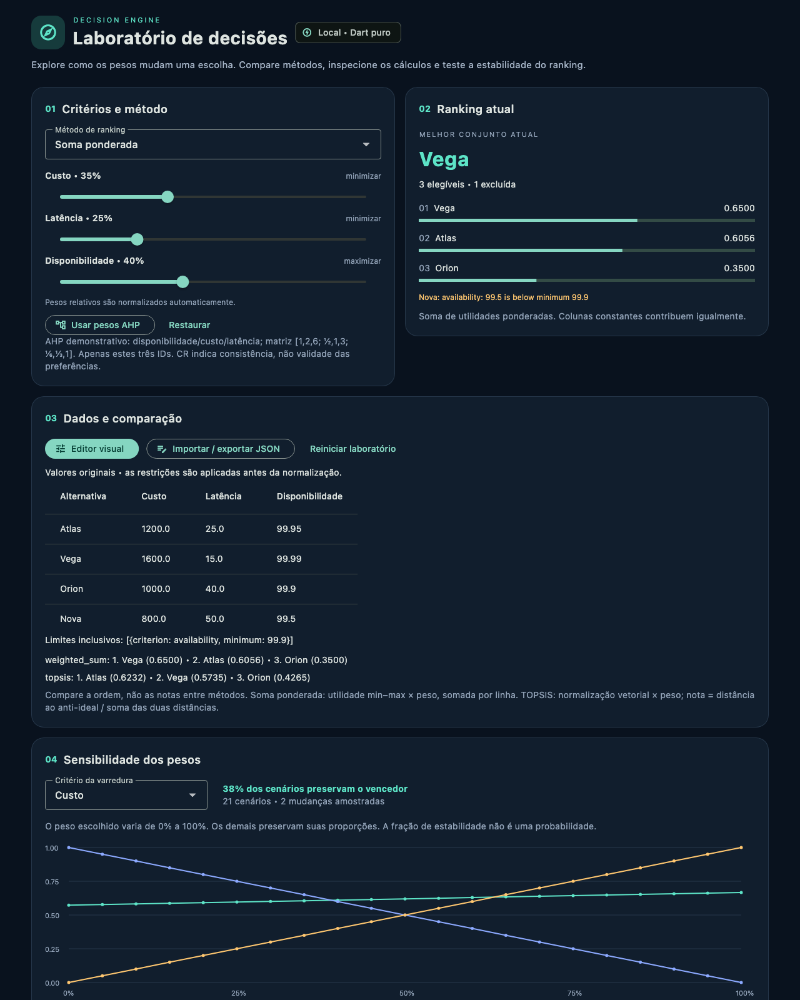

# decision_engine

[](https://pub.dev/packages/decision_engine)
[](https://pub.dev/packages/decision_engine/score)

[](https://github.com/kleberandrade/decision-engine/actions/workflows/ci.yml)
[](https://dart.dev)
[](LICENSE)

**Explainable multicriteria decisions in pure Dart** for Flutter apps and Dart
services. Compose criteria, eligibility requirements and ranking strategies.
No runtime dependencies, Flutter imports, IO or network access in the core.

[Português](README.pt-BR.md) · [Getting started](doc/getting_started.md) ·
[Methods and equations](doc/methods.md) · [Architecture](doc/architecture.md) ·
[Online lab](https://kleberandrade.github.io/decision-engine/) ·
[Scenario guide](example/flutter_lab/SCENARIOS.md) · [Sensitivity](doc/sensitivity.md) · [Flutter lab](example/flutter_lab/README.md) ·
[AHP weighting](doc/ahp.md) · [Custom strategies](doc/extending.md) · [Roadmap](doc/roadmap.md) ·
[Contributing](CONTRIBUTING.md)

## Status and installation

The stable **0.3.0** is published under verified publisher
[kleberandrade.dev](https://pub.dev/publishers/kleberandrade.dev) with **160/160 pub
points** (verified 2026-11-17). It includes AHP and sampled weight sensitivity.
The optional Flutter laboratory consumes this checkout's source. Core Dart
support remains >=3.3.0 <4.0.0.

```yaml
dependencies:
  decision_engine: ^0.3.0
```

Run `dart pub add decision_engine` or `flutter pub add decision_engine` to select
the latest available compatible hosted version. AHP requires **0.2.0 or newer**;
sensitivity requires **0.3.0 or newer**. Check the
[hosted version list](https://pub.dev/packages/decision_engine/versions).
Source changes under Unreleased are not automatically published to pub.dev.

## Explore the laboratory

Use labeled visual forms to edit alternatives, criteria, weights and inclusive constraints; compare weighted
sum with TOPSIS and inspect calculation traces. Import/export JSON to reproduce a
scenario. The [bilingual scenario guide](example/flutter_lab/SCENARIOS.md) explains
calculations, sensitivity, the fixed AHP demonstration and limits.



## Choose a provider

```dart
import 'package:decision_engine/decision_engine.dart';

void main() {
  final engine = DecisionEngine(
    criteria: [
      Criterion.minimize('cost', weight: 0.35),
      Criterion.minimize('latency', weight: 0.25),
      Criterion.maximize('availability', weight: 0.40),
    ],
    constraints: [MinimumValue('availability', 99.9)],
    method: const Topsis(),
  );

  final result = engine.evaluate([
    Alternative('Provider A', values: {
      'cost': 1200, 'latency': 25, 'availability': 99.95,
    }),
    Alternative('Provider B', values: {
      'cost': 1600, 'latency': 15, 'availability': 99.99,
    }),
    Alternative('Provider C', values: {
      'cost': 900, 'latency': 40, 'availability': 99.5,
    }),
  ]);

  print(result.best?.name);
  for (final entry in result.ranking) {
    print('${entry.rank}: ${entry.alternative.name} = ${entry.score}');
  }
  print(result.excluded.single.reasons);
  print(result.trace?.normalized);
}
```

Provider C is excluded before normalization. Use `const WeightedSum()` to select
direction-aware min-max normalization with additive weighted contributions.
Run the full example with `dart run example/decision_engine_example.dart`.

## Included methods

| Strategy | Normalization | Result | Best fit |
| --- | --- | --- | --- |
| `WeightedSum` | Min-max, oriented to preference | Sum of weighted utilities | Transparent additive trade-offs |
| `Topsis` | Column Euclidean vector norm | Closeness to ideal / distance from anti-ideal | Ideal-point comparisons |

Both methods accept signed finite observations and nonnegative relative weights.
Weights are normalized automatically; at least one must be positive. Zero weights
remove the corresponding criterion's influence on ranking. Hard constraints on
that criterion still apply. Constant columns cannot distinguish alternatives.
See [method conventions and limitations](doc/methods.md).

## Inspect the decision

- `ranking`: descending scores with competition ranks (`1, 1, 3`). Exact ties
  preserve input order; `best` is the first tied alternative, not a unique winner.
- `excluded`: original alternatives with every failed requirement.
- `criteria` and `weights`: column identities and normalized relative weights.
- `eligible`: original input row order, used by all trace matrices.
- `trace.normalized` and `trace.weighted`: immutable calculation matrices.
- TOPSIS `trace.diagnostics`: `distanceToIdeal` and `distanceToAntiIdeal` per row.

Empty input or an entirely rejected set returns `best == null`, an empty ranking
and `trace == null`. Scores belong to one method and eligible set; do not compare
them across methods or treat them as probabilities. Adding or removing options
can change normalization and the ranking, even for unchanged alternatives.

## Extend without changing the engine

Implement `DecisionMethod` or `DecisionConstraint` and compose it through the
public entry point. See [custom method example](example/custom_method.dart).
Strategies must return finite, dimensionally correct traces; the engine checks
this boundary. Tests and consumers import `package:decision_engine/decision_engine.dart`.

## Development

```sh
dart pub get
dart analyze --fatal-infos
dart test
dart run example/decision_engine_example.dart
dart run example/weighted_sum.dart
dart run example/custom_method.dart
dart run example/ahp.dart
dart run example/sensitivity.dart
dart pub publish --dry-run
```

Documentation is maintained in English and Brazilian Portuguese. AHP is available in 0.2.0. This development branch adds sampled sensitivity
and a separate Flutter lab. See
[roadmap](doc/roadmap.md), [validation](doc/validation.md) and [changelog](CHANGELOG.md).

## Generate weights with AHP

This section describes the **0.2.0 API**. It is not available in hosted 0.1.0.

Use `AhpWeighting().evaluate(criterionIds: ..., comparisons: ...)` to derive
principal-eigenvector weights from 1–10 reciprocal comparisons. Inspect CI/CR,
then call `toCriteria` with explicit maximize/minimize directions. Inconsistent
judgments are rejected by this conversion unless explicitly opted into.
See the [AHP guide](doc/ahp.md) and `example/ahp.dart` for the complete workflow.

## Explore weight sensitivity (0.3.0)

```dart
final report = SensitivityAnalyzer(engine: engine).sweep(alternatives,
  criterionId: 'cost', weights: [0, 0.25, 0.5, 0.75, 1],
);
print(report.baselineWinners);
print(report.winnerStability);
print(report.transitions);
```

Use `WeightScenario` and `analyze` for complete alternative weight sets. The
full winner set is compared, including ties. Transition brackets describe samples,
not exact decision boundaries; stability is not a probability. See the
[bilingual sensitivity guide](doc/sensitivity.md) and executable example.

Run the separate [Flutter lab](example/flutter_lab/README.md) with
`flutter run -d chrome` from its directory. It visualizes weights, method choices,
sampled score curves and calculation matrices. The core has no Flutter dependency.
The lab requires Flutter >=3.35.0; it does not change the core SDK floor.
