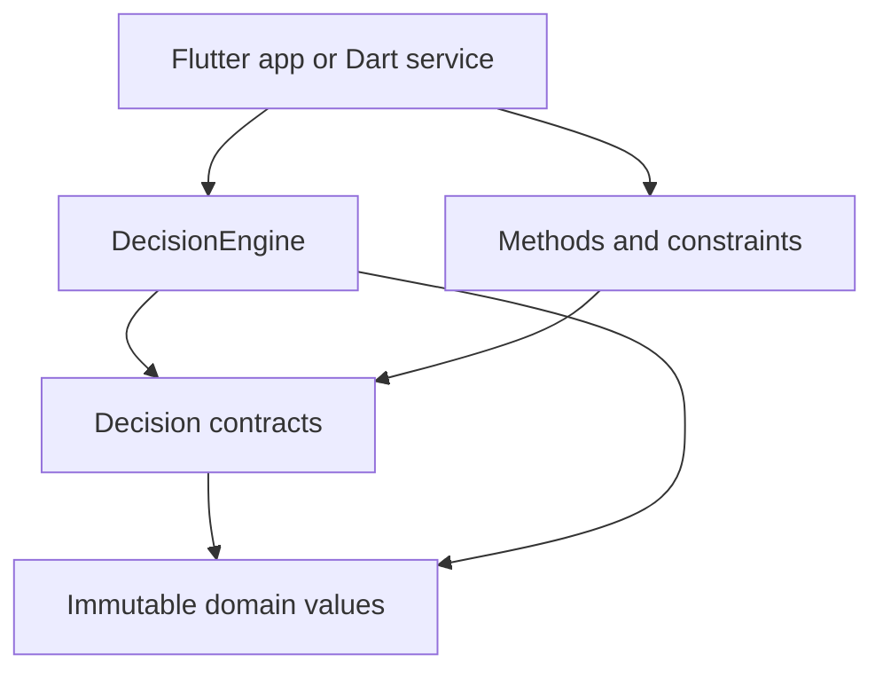

# Architecture

[Português](architecture.pt-BR.md)

The engine orchestrates eligibility and ranking. Methods own numeric semantics;
constraints own rejection rules. Consumers compose interfaces through one import.

| Location | Responsibility | Allowed dependencies |
| --- | --- | --- |
| `lib/decision_engine.dart` | Public exports | No runtime logic |
| `lib/src/domain/` | Criteria, alternatives, validated matrix, traces, results | SDK and domain |
| `lib/src/contracts/` | Method and constraint extension boundaries | SDK and domain |
| `lib/src/methods/` | Normalization, weighting, scores, diagnostics | SDK, domain, contracts |
| `lib/src/constraints/` | Inclusive bounds | SDK and contracts |
| `lib/src/weighting/` | AHP weights, consistency diagnostics and result conversion | SDK and criterion domain |
| `lib/src/sensitivity/` | Scenario orchestration and sampled comparisons | SDK, domain and public engine |
| `lib/src/engine/` | Validate, filter, delegate, check output, rank | SDK, domain, contracts |
| `test/` | Public behavior and strategy boundary checks | Public entry point |

Configuration and values are defensively copied. Nested matrices, diagnostics
and maps are unmodifiable. Each evaluation owns its eligible set, trace and ranking;
no mutable global state, registry or concrete method import exists in the engine.
Custom strategies must be stateless or manage their own state safely. Custom
constraints are referenced, not cloned; their behavior must remain stable.

Trace rows follow `result.eligible`, while ranking is independently sorted.
Columns follow `result.criteria`. Strategy output is checked for finite values and
matching dimensions, not mathematical correctness. Custom methods define their
own normalization and score scale, and must use descending preference.

The core does not own HTTP, UI, persistence, isolates, or integrations with other
engines. Flutter can call it directly for small matrices; large evaluations may
need application-managed isolates. Both built-ins take O(rows * columns) numeric
work and memory; final ranking adds O(rows * log(rows)).

AHP is a separate preprocessing step, not a decision-method implementation.
It produces criteria without adding any dependency to the engine or ranking
strategies. Its immutable result owns the CI/CR policy and conversion gate.

## Sensitivity and UI boundary

The analyzer composes an immutable engine configuration and re-evaluates it for
validated complete weight scenarios. It preserves directions/constraints and
compares full winner sets, not the first display item. Sweep generation preserves
complementary proportions; zero complementary mass has no invented fallback.
Eligibility changes from stateful extensions are rejected explicitly.

The Flutter lab lives in a separate package under `example/flutter_lab`, consumes
the root via a path dependency and is excluded from core Dart analysis. It draws
sampled score curves with Flutter's painter; no chart, HTTP or UI dependency is
added to the library. Native preview tooling lives inside that example only.
